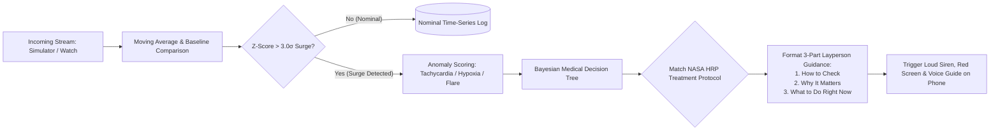
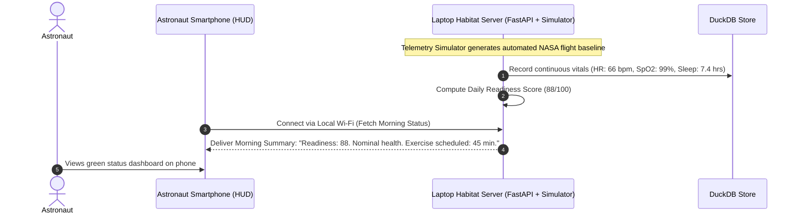
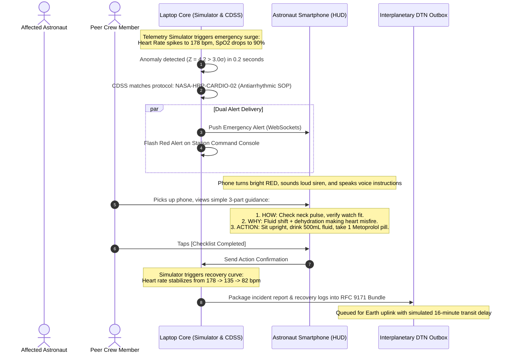
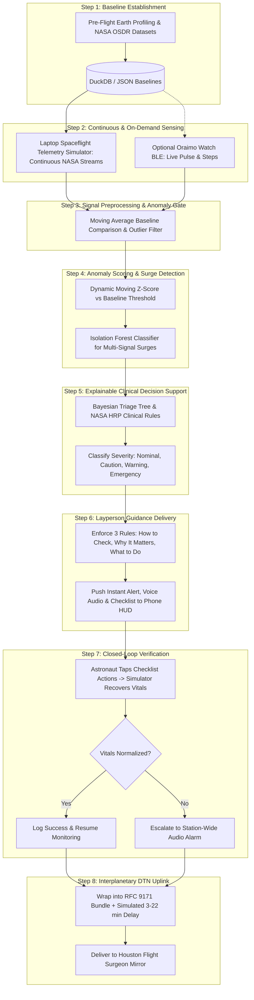

# AURA-MED: Autonomous Exploration Readiness & Medical Engine
### NASA Deep-Space Autonomous Clinical Decision Support System (CDSS)
**NASA Space Apps Challenge 2026 | Powered by NASA Human Research Program (HRP) & Open Science Data Repository (OSDR)**

---

## 1. Executive Summary & Ground Truth

### 1.1 The Deep-Space Paradigm Shift
As humanity pushes beyond Low Earth Orbit (LEO) toward the Moon (Artemis program) and Mars, astronauts face an unprecedented medical reality: **complete independence from Earth Mission Control**.
* **Interplanetary Radio Latency:** One-way radio propagation between Mars and Earth requires **3 to 22 minutes**, creating a round-trip delay of **6 to 44 minutes**.
* **Solar Conjunction Blackouts:** Every 26 months, the Sun physically obstructs communication lines for ~14 consecutive days.
* **The Operational Reality:** **Astronauts are astrophysicists, aerospace engineers, and test pilots—they are not certified doctors or trauma surgeons.**

If a crew member suffers acute cardiac decompensation, microgravity fluid shifts, cabin air toxicity, or immune breakdown halfway to Mars, Houston cannot guide them in real time. The spacecraft requires an autonomous, self-sufficient clinical brain.

```
       REAL-TIME TELEMEDICINE GAP (DEEP SPACE MARS TRANSIT)
[Astronaut in Distress] ---> (3-22 min light delay) ---> [Houston Flight Surgeon]
                                                               | (Reviewing)
[Irreversible Harm]     <--- (3-22 min light delay) <--- [Doctor's Orders]
--------------------------------------------------------------------------------
           AURA-MED LOCAL EDGE COMPUTATION (< 200 MILLISECONDS)
[Astronaut in Distress] ---> [Local AURA-MED Core] ---> [Immediate Triage & SOP]
```

### 1.2 The Developer Feasibility Grounding: Realistic Simulation & Simple Hardware
**We are a practical team of software developers.** We do not possess medical lab equipment, hospital patient monitors, or expensive proprietary flight hardware. Our real physical inventory consists of:
1. **Developer Laptops:** The central simulation engine and habitat medical brain.
2. **Standard Smartphone:** The astronaut's handheld tactical screen (Emergency HUD), audio alarm, and voice-guided checklist assistant.
3. **Oraimo Smart Watch:** An accessible budget wearable worn on the wrist to capture live pulse and movement via Bluetooth (BLE) as an optional live stream.

**Our Core Engineering Approach:** *Automate and simulate the deep-space health data so we can focus on what matters: the autonomous clinical response.*
Instead of pretending a smartphone camera can perform complex clinical lab tests, **AURA-MED builds a high-fidelity Spaceflight Telemetry & Anomaly Simulator on the laptop**:
* **Simulated Telemetry Engine:** Generates realistic, automated astronaut physiological streams (Heart Rate, SpO2, Sleep Fatigue, Immune Biomarkers) calibrated against published **NASA Human Research Program (HRP)** and **NASA Open Science Data Repository (OSDR)** data.
* **Instant Anomaly & Surge Injection:** The laptop can trigger realistic emergency scenarios (e.g., Acute Tachycardia, Sudden Cabin Hypoxia, Immune Suppression Flare) with a single click or scheduled timer.
* **The Phone as the Handheld Crew HUD:** The phone does not do unrealistic sensing tricks. Instead, it acts as the astronaut's lifeline: receiving the stream over local Wi-Fi, sounding loud emergency sirens when surges occur, speaking plain-English guidance aloud, and presenting a simple 1-2-3 checklist.
* **The Oraimo Watch as an Optional Live Link:** Pairs via standard Bluetooth (BLE) to feed live pulse and step counts into the laptop stream, proving our software ingests real consumer wearable hardware.

### 1.3 Terrestrial Dual-Use: Extreme Healthcare for Marginalized Communities
This exact architecture makes AURA-MED immediately deployable in underserved terrestrial environments:
* **Rural Clinics with No Doctor:** A remote clinic in Kenya or Central Asia with no internet can run the CDSS on a cheap laptop while health workers carry low-cost phones to receive automated triage guidance during emergencies.
* **Disaster & Off-Grid Zones:** Works completely offline without cloud servers, satellite connections, or expensive medical machines.

---

## 2. NASA Reference Grounding & Scientific Mapping

This architecture is directly grounded in the official repositories referenced in `references.md`:

```
+---------------------------------------------------------------------------------------------------+
|                           NASA REFERENCES & INVESTIGATION MAPPINGS                                |
+---------------------------------------------------------------------------------------------------+
| Reference Link                   | Active NASA Investigation         | Implemented System Feature |
|----------------------------------+-----------------------------------+----------------------------|
| NASA Human Research Program (HRP)| • ARCHeR Study (Artemis II)       | Wearable actigraphy, sleep |
| https://www.nasa.gov/hrp/        |   Activity & sleep patterns       | cycles, fatigue modeling   |
| ongoing-hrp-research/            | • Immune Biomarkers (Artemis II)  | Simulated saliva immune    |
|                                  |   Saliva/blood deep space immune  | indicators & viral flare   |
|                                  | • Artemis Standard Measures       | Nutritional balance, heart |
|                                  |   Longitudinal crew data banks    | rate recovery, baseline Z  |
|                                  | • Brain Fluid Pressure & SANS     | Microgravity fluid shift & |
|                                  |   Intracranial pressure & vision  | cephalic blood pooling     |
|                                  | • Thigh Cuff & Venous Haemostasis | Blood pooling detection,   |
|                                  |   Fluid shift & coagulation risks | compression garment alert  |
|                                  | • Zero T2 (Exercise Without T2)   | Physical workout adherence |
|----------------------------------+-----------------------------------+----------------------------|
| NASA Open Science Data Repository| • OSDR-379 / GeneLab GLDS-242     | Benchmark baseline for T-  |
| (OSDR / PSI)                     |   Spaceflight immune suppression  | cell suppression modeling  |
| https://science.nasa.gov/        | • ALSDA Flight Physiology Data    | Authentic astronaut vitals |
| biological-physical/data/        |   Pre-flight vs in-flight vitals  | replayed in simulator      |
|----------------------------------+-----------------------------------+----------------------------|
| NASA Space Apps Challenge Portal | • "Create Health Monitoring       | Autonomous triage, explain |
| spaceappschallenge.org           |   Software for Astronauts"        | how/why/what, dual-screen  |
+---------------------------------------------------------------------------------------------------+
```

---

## 3. Realistic Hardware & Simulation Strategy

Here is the realistic, transparent technical breakdown of our practical setup:

```
+---------------------------------------------------------------------------------------------------+
|                                REALISTIC HARDWARE & SIMULATION ROLES                              |
+---------------------------------------------------------------------------------------------------+
| Device                | Primary Function               | How It Works in Practice        | Cost   |
|-----------------------+--------------------------------+---------------------------------+--------|
| Developer Laptop      | Simulator & Habitat Brain      | Runs Python/FastAPI backend,    | $0     |
|                       |                                | DuckDB, and Telemetry Simulator | (Owned)|
|                       |                                | Injects health surges/anomalies |        |
|                       |                                | Displays Station Command Screen |        |
|-----------------------+--------------------------------+---------------------------------+--------|
| Standard Smartphone   | Astronaut Tactical Mobile HUD  | Connects via local Wi-Fi / IP   | $0     |
|                       | (Display, Alarm, Voice, SOPs)  | Displays live vital dials       | (Owned)|
|                       |                                | Triggers loud alarm on surges   |        |
|                       |                                | Speaks voice guidance aloud     |        |
|                       |                                | Shows interactive 1-2-3 checklist|       |
|-----------------------+--------------------------------+---------------------------------+--------|
| Oraimo Smart Watch    | Optional Live Wearable Stream  | Connects via standard BLE       | ~$25   |
|                       |                                | Feeds real pulse & daily steps  | (Basic)|
|-----------------------+--------------------------------+---------------------------------+--------|
| NASA OSDR Datasets    | Realistic Data Foundation      | Pre-loaded spaceflight baselines| $0     |
|                       |                                | used by the simulator           | (Open) |
+---------------------------------------------------------------------------------------------------+
```

### 3.1 The Spaceflight Telemetry & Anomaly Simulator (Laptop)
Instead of building complex, fragile hardware sensors, we automate the medical telemetry:
1. **Automated Baseline Stream:** The laptop continuously generates normal spaceflight telemetry (Heart Rate: 65–75 bpm, SpO2: 98–99%, Sleep Duration: 7.2 hours, Immune Status: Nominal) calibrated against NASA HRP research.
2. **One-Click Anomaly Injection:** Developers or judges can trigger real emergency scenarios from the laptop keyboard or web console:
   * **Cardiac Spike:** Spikes heart rate to 175 bpm and drops HRV, simulating acute microgravity arrhythmia.
   * **Hypoxia / CO2 Alert:** Drops SpO2 to 89% and elevates respiration, simulating cabin scrubber failure.
   * **Immune Viral Flare:** Simulates elevated salivary stress markers and viral reactivation.
3. **Automated Recovery Loop:** When the astronaut marks a treatment checklist as "Completed" on the phone, the simulator automatically relaxes the vitals back to normal over a realistic recovery curve.

### 3.2 The Smartphone: Crew Mobile HUD & Emergency Assistant
The phone does not pretend to be a medical sensor. It does what phones do best: **act as the astronaut's handheld personal interface**:
1. **Always-On Dashboard:** Connects to the laptop over the local network to show current status with large, high-contrast gauges.
2. **Loud Siren & Visual Alarm:** The second the laptop detects a simulated surge, the phone turns bright red and beeps loudly.
3. **Synthesized Voice Guidance:** Uses the browser’s built-in WebSpeech API to read out calm, clear instructions so the astronaut doesn't have to squint at small text during a panic.
4. **Interactive Action Checklist:** Large, glove-friendly check-boxes to confirm actions (e.g., *"Took 1 tablet of Metoprolol"*).

### 3.3 The Oraimo Smartwatch Integration (Optional Live Stream)
* If an Oraimo watch is on hand, we connect it over **Bluetooth Low Energy (BLE)** using the standard Heart Rate Service (`0x180D`).
* The laptop ingests the watch's live pulse and step counts and blends them into the simulated spaceflight telemetry stream.
* If no watch is connected, the simulator runs automatically without throwing any errors.

---

## 4. Multi-Tier Distributed System Architecture

```
+---------------------------------------------------------------------------------------------------+
|                                 AURA-MED 3-TIER SYSTEM ARCHITECTURE                               |
+---------------------------------------------------------------------------------------------------+
|                                                                                                   |
|  [ TIER 1: CREW EDGE - SMARTPHONE HANDHELD HUD ]                                                  |
|  +---------------------------------------------------------------------------------------------+  |
|  | Astronaut Smartphone (Mobile Web / PWA Client)                                              |  |
|  | - Connected to Laptop via Local Offline Wi-Fi / Hotspot                                     |  |
|  | - Displays Real-Time Vital Gauges & Readiness Score                                         |  |
|  | - Triggers Audible Alarm & High-Contrast Red Screen upon Anomaly Surges                     |  |
|  | - Speaks Plain-English Instructions via Voice Synthesis                                      |  |
|  | - Interactive 3-Step Emergency Action Checklist (Glove-Friendly)                            |  |
|  +---------------------------------------------------------------------------------------------+  |
|                                                ^                                                  |
|                                                | Local Wi-Fi WebSocket & REST                     |
|                                                v                                                  |
|  [ TIER 2: HABITAT CORE - DEVELOPER LAPTOP (SIMULATOR + MEDICAL BRAIN) ]                          |
|  +---------------------------------------------------------------------------------------------+  |
|  | Spacecraft Medical Core (Developer Laptop)                                                   |  |
|  | 1. Spaceflight Telemetry Simulator:                                                         |  |
|  |    - Generates NASA-calibrated continuous vitals (HR, SpO2, sleep, immune)                   |  |
|  |    - One-click trigger for emergency surges (Arrhythmia, Cabin Hypoxia, Viral Flare)        |  |
|  |    - (Optional) Ingests live pulse & steps from paired Oraimo Watch via BLE                  |  |
|  | 2. Analytical Diagnostic Core:                                                              |  |
|  |    - DuckDB Columnar Time-Series Database (Fast local query engine)                          |  |
|  |    - Anomaly Detector: Flags statistical surges (> 3.0σ deviation from baseline)            |  |
|  |    - Bayesian Clinical Decision Support (CDSS): Matches NASA HRP medical protocols          |  |
|  | 3. Station Command Console:                                                                 |  |
|  |    - Full habitat multi-crew status display on laptop screen                                 |  |
|  |    - Interplanetary DTN transmission queue (Simulates 3 to 22 min delay to Earth)           |  |
|  +---------------------------------------------------------------------------------------------+  |
|                                                |                                                  |
|                                                | Asynchronous DTN Radio Bundle                    |
|                                                | (Simulated 3-22 minute light delay)              |
|                                                v                                                  |
|  [ TIER 3: EARTH MISSION CONTROL CONSOLE (SIMULATED HOUSTON MIRROR) ]                            |
|  +---------------------------------------------------------------------------------------------+  |
|  | Earth Ground Console View                                                                   |  |
|  | - Buffers incoming incident packets by simulated interplanetary transit delay               |  |
|  | - Shows Houston Flight Surgeons historical log of what happened and how the system reacted   |  |
|  +---------------------------------------------------------------------------------------------+  |
+---------------------------------------------------------------------------------------------------+
```

---

## 5. Data Flow Diagrams (DFDs)

### 5.1 DFD Level 0: Context Diagram
```mermaid
flowchart TD
    Astronaut([Astronaut / Crew Responder])
    OraimoWatch([Oraimo Smart Watch\n(Optional Live BLE)])
    Simulator([Spaceflight Telemetry Simulator\n(Automated NASA Scenarios)])
    LaptopCore[("AURA-MED Habitat Medical Core\n(FastAPI + DuckDB + CDSS)")]
    PhoneHUD([Astronaut Smartphone HUD\n(Display, Voice, Checklist)])
    EarthSurgeon([Earth Mission Control / Flight Surgeon])

    Simulator -- "Simulated Continuous Vitals & Injected Surges" --> LaptopCore
    OraimoWatch -. "Live Pulse & Daily Steps (BLE)" .-> LaptopCore
    Astronaut -- "Emergency Checklist Confirmations & Symptom Notes" --> PhoneHUD
    PhoneHUD -- "Checklist State & Acknowledgments" --> LaptopCore

    LaptopCore -- "Instant Status, Loud Alarms & Layperson Guidance" --> PhoneHUD
    LaptopCore -- "Asynchronous RFC 9171 DTN Bundles (Delayed 3-22 min)" --> EarthSurgeon
    EarthSurgeon -. "Non-urgent Medical Guidance Updates" .-> LaptopCore
```

---

### 5.2 DFD Level 1: Subsystem Functional Decomposition
```mermaid
flowchart TD
    subgraph Ingestion_Pipeline [1.0 Ingestion & Scenario Engine]
        P1[1.1 Oraimo BLE Ingestion Module]
        P2[1.2 Spaceflight Telemetry & Anomaly Simulator]
        P3[1.3 Crew Checklist & Response Ingest]
    end

    subgraph Data_Stores [Local Storage Sinks]
        DS1[("D1: DuckDB Time-Series Store")]
        DS2[("D2: Pre-Flight Baseline Store (JSON)")]
        DS3[("D3: NASA HRP Clinical Protocols DB")]
        DS4[("D4: Interplanetary DTN Outbox")]
    end

    subgraph Analytical_Engine [2.0 Anomaly & Diagnostic Engine]
        P4[2.1 Rolling Z-Score & Statistical Gate]
        P5[2.2 Multi-Signal ML Anomaly Detector]
        P6[2.3 Bayesian Clinical Decision Support (CDSS)]
    end

    subgraph User_Interfaces [3.0 Guidance & Visualization]
        P7[3.1 Astronaut Mobile HUD (Phone Web App)]
        P8[3.2 Step-by-Step Voice & Checklist Engine]
        P9[3.3 Station Medical Command Console (Laptop)]
        P10[3.4 DTN Latency Buffer & Uplink Agent]
    end

    P1 -.->|Live Pulse/Steps| DS1
    P2 -->|Simulated NASA Vitals & Surges| DS1
    P3 -->|Confirmed Actions| P6

    DS1 --> P4
    DS2 --> P4
    P4 -->|Normalized Residuals| P5
    P5 -->|Flagged Anomalies| P6
    DS3 -->|NASA Treatment SOPs| P6

    P6 -->|Triage State & Layperson Guidance| P7
    P6 -->|Audio Alarm & Checklist| P8
    P6 -->|Multi-Crew Status Matrix| P9
    P6 -->|Encrypted Medical Event Logs| DS4
    DS4 --> P10
```

---

### 5.3 DFD Level 2: Anomaly Detection & Emergency Action Pipeline


---

## 6. Information Flow & Component Interactions

### 6.1 Daily Routine Flow (Automated Baseline & Morning Status)


---

### 6.2 Acute Emergency Workflow (Simulated Tachycardia Surge)


---

## 7. Comprehensive Clinical Use Cases (Simulation & Response Scenarios)

Every use case below can be run and tested directly using the **Spaceflight Simulator (`backend/app/simulator/replayer.py`)** or triggered with a single click in the developer console.

### Use Case 1: Tachyarrhythmia & Fluid Shift Under Microgravity
* **Primary Actor:** Non-physician Astronaut (Flight Engineer).
* **System Trigger:** Simulator injects sudden resting heart rate spike to 178 bpm and SpO2 drop to 90% (or triggered via `POST /api/v1/simulator/trigger {"scenario": "cardiac_spike"}`).
* **Step-by-Step Flow:**
  1. The laptop simulation stream pushes the surge into the DuckDB pipeline.
  2. Laptop CDSS runs moving Z-score ($Z = 4.2 > 3.0\sigma$) and identifies acute non-sinus tachycardia.
  3. Smartphone HUD immediately beeps loudly, flashes high-contrast RED, and speaks voice instructions.
  4. **How to Check:** The phone instructs: *"Sit down, remain calm, and check your wrist pulse against the Oraimo watch display."*
  5. **Why It Matters:** *"In zero-g, bodily fluids shift toward your chest, decreasing blood volume and causing your heart muscle to overcompensate."*
  6. **What to Do:** Interactive 3-step checklist:
     * [ ] Step 1: Drink 500 mL of chilled electrolyte fluid pack.
     * [ ] Step 2: Sit in sleep quarters with legs anchored.
     * [ ] Step 3: Take 1 tablet of Metoprolol (50 mg) from MedKit Locker Alpha.
  7. Astronaut checks the boxes on screen. The simulator registers the treatment and smoothly returns heart rate to 82 bpm over a realistic recovery curve.
* **Postconditions:** Event logged; bundled for simulated 16-minute radio transmission to Earth.

---

### Use Case 2: Immune Dysregulation & Latent Viral Reactivation
* **Primary Actor:** Astronaut (Payload Specialist).
* **System Trigger:** Simulator injects chronic stress profile (simulated low sleep duration, radiation spike, and elevated immune suppression index).
* **Step-by-Step Flow:**
  1. Laptop CDSS correlates multi-day simulated immune metrics and flags risk of latent viral reactivation (Varicella-Zoster / Herpes Simplex).
  2. Smartphone displays Amber caution card with plain-language explanation:
  3. **Why It Matters:** *"Deep space radiation and sleep debt have suppressed your T-cell immune defenses, making dormant childhood viruses wake up."*
  4. **What to Do:**
     * [ ] Step 1: Inspect skin for localized red tingling rash.
     * [ ] Step 2: Retrieve Valacyclovir (500 mg) from Medical Kit Box 4 and take 1 tablet.
     * [ ] Step 3: Prioritize 8 hours uninterrupted sleep in dark cabin.
  5. Astronaut taps confirmation; medication schedule automatically logs on the system.
* **Postconditions:** Medication course tracked; prevents full-blown shingles outbreak in cabin.

---

### Use Case 3: Toxic Cabin Hypercapnia ($\text{CO}_2$ Accumulation) & Hypoxia
* **Primary Actor:** Full Crew (4 Members).
* **System Trigger:** Simulator injects simulated ECLSS air scrubber failure: cabin $p\text{CO}_2$ rises from 3.0 to 9.5 mmHg; all crew vitals show elevated respiration and SpO2 falling to 89%.
* **Step-by-Step Flow:**
  1. Laptop Core recognizes a simultaneous multi-person vital drop combined with environmental sensor surge.
  2. Diagnostic tree rules out individual illness and declares **Station-Wide Air Toxicity Alert**.
  3. All smartphones and the laptop wall console sound emergency klaxon: *"CABIN AIR WARNING: High Carbon Dioxide Detected."*
  4. Voice synthesizer announces: *"Crew attention: Don Emergency Breathing Masks immediately."*
  5. Station Console displays scrubber bypass valve schematic and countdown timer to air restoration.
* **Postconditions:** Scrubber canister swapped; cabin purged; simulated oxygen levels return to 99%.

---

### Use Case 4: Neuro-Ocular SANS & Fluid Shift Management
* **Primary Actor:** Astronaut.
* **System Trigger:** Scheduled bi-weekly spaceflight health milestone check generated by the simulator.
* **Step-by-Step Flow:**
  1. Phone displays scheduled notification: *"Scheduled Health Check: Neuro-Ocular Fluid Shift."*
  2. Astronaut reviews self-check questions on the phone screen (e.g., visual blurriness, headache intensity).
  3. CDSS cross-references simulated microgravity duration (Day 80) and predicts intracranial venous pressure increase.
  4. **Why It Matters:** *"Without gravity pulling blood down, excess fluids accumulate in your skull and press against your optic nerve."*
  5. **What to Do:**
     * [ ] Step 1: Increase daily Lower Body Negative Pressure (LBNP) chamber session by 30 minutes.
     * [ ] Step 2: Tighten thigh compression cuffs during waking hours.
* **Postconditions:** Countermeasure logged; prevents irreversible vision changes.

---

### Use Case 5: Musculoskeletal Fatigue & Pre-EVA Spacewalk Gate
* **Primary Actor:** Spacewalk Lead.
* **System Trigger:** Pre-EVA automated clearance check triggered 12 hours before scheduled airlock egress.
* **Step-by-Step Flow:**
  1. Simulator evaluates past 7 days of simulated physical exercise wattage, sleep continuity, and caloric balance.
  2. Simulator injects high fatigue profile: cumulative 10-hour sleep debt.
  3. CDSS calculates **Readiness Score: 58/100 (FAIL: < 75 threshold)**.
  4. Commander Console flags: *"Crew Member 2 NOT cleared for spacewalk due to acute muscle and central nervous fatigue."*
  5. Recommends swapping EVA assignment to Crew Member 3 and prescribing 8 hours rest.
* **Postconditions:** Commander accepts recommendation; prevents life-threatening suit handling error.

---

### Use Case 6: Mars Surface Landing & Orthostatic Collapse Prevention
* **Primary Actor:** Astronaut transitioning from 0g to Mars 0.38g gravity.
* **System Trigger:** Simulator triggers landing sequence: posture transition with sudden heart rate surge (70 to 155 bpm) and blood pressure dip upon touchdown.
* **Step-by-Step Flow:**
  1. System detects acute Orthostatic Intolerance (blood pooling in lower extremities under sudden Mars gravity).
  2. Phone sounds piercing audible chirp: *"FALL HAZARD: Lie flat on your back immediately!"*
  3. **Why It Matters:** *"Your cardiovascular system spent 7 months in zero gravity and forgot how to pump blood upward against gravity. Blood is rushing to your feet."*
  4. **What to Do:**
     * [ ] Step 1: Lie flat and elevate legs 30 degrees.
     * [ ] Step 2: Inflate Lower Body Compression Garment to 40 mmHg.
     * [ ] Step 3: Drink 1 Liter chilled electrolyte fluid.
* **Postconditions:** Astronaut assumes supine posture; cerebral blood flow restores; syncope avoided.

---

## 8. Step-by-Step Technical Execution & Clinical Flow



---

## 9. Data Models, Schemas & API Specifications

The system runs a **FastAPI** backend on the laptop, communicating with the smartphone PWA via REST and real-time WebSockets.

### 9.1 Ingestion Payload (`POST /api/v1/telemetry/ingest`)
```json
{
  "astronaut_id": "ASTRO-01-ELENA",
  "timestamp": "2026-10-14T09:15:30.000Z",
  "source": "SIMULATOR-NASA-HRP",
  "vitals": {
    "heart_rate_bpm": 178.0,
    "spo2_percent": 90.0,
    "respiration_rate": 26.0,
    "skin_temp_celsius": 36.8
  },
  "kinetics": {
    "posture": "SUPINE",
    "activity_mode": "REST",
    "accel_magnitude": 0.02
  },
  "environmental": {
    "cabin_co2_mmhg": 3.8,
    "cabin_pressure_psi": 14.7,
    "radiation_rate_usv_h": 12.4
  }
}
```

### 9.2 Diagnostic Evaluation Response (`POST /api/v1/triage/evaluate`)
```json
{
  "evaluation_id": "EVAL-2026-4412",
  "timestamp": "2026-10-14T09:15:30.410Z",
  "astronaut_id": "ASTRO-01-ELENA",
  "triage_state": "WARNING",
  "confidence": 0.94,
  "condition": "Acute Microgravity Tachyarrhythmia",
  "guidance": {
    "how_to_check": "Sit upright against cabin wall, remain calm, and check wrist pulse against Oraimo watch.",
    "why_it_matters": "In zero-g, bodily fluids shift toward your chest, decreasing blood volume and causing your heart to overcompensate.",
    "what_to_do": [
      {
        "step": 1,
        "action": "Immediate Rest & Hydration",
        "detail": "Cease activity. Consume 500 mL of chilled electrolyte pack immediately.",
        "completed": false
      },
      {
        "step": 2,
        "action": "Administer Oral Beta-Blocker",
        "detail": "Retrieve Medical Box 2 from Locker Alpha. Ingest 1 tablet of Metoprolol (50 mg).",
        "completed": false
      }
    ]
  },
  "dtn_bundle_id": "BUNDLE-MARS-2026-8819",
  "dtn_simulated_delay_sec": 960
}
```

### 9.3 REST API Endpoints

| Method | Endpoint | Description | Request Payload | Response |
| :--- | :--- | :--- | :--- | :--- |
| `POST` | `/api/v1/telemetry/ingest` | Ingest live / simulated telemetry | `TelemetryPayload` | `200 OK` |
| `POST` | `/api/v1/simulator/trigger` | Trigger simulated emergency surge | `{"scenario": "cardiac_spike"}`| `SimulatorStatus` |
| `POST` | `/api/v1/checklist/confirm` | Confirm emergency checklist step | `{"step_id": 1, "done": true}` | `ChecklistStatus` |
| `POST` | `/api/v1/triage/evaluate` | Run CDSS on current vitals & symptoms | `TriageRequest` | `DiagnosticResponse`|
| `GET` | `/api/v1/crew/readiness` | Multi-crew readiness score matrix | None | `ReadinessMatrix` |
| `GET` | `/api/v1/dtn/queue` | View interplanetary sync queue | None | `DTNQueueStatus` |

### 9.4 Real-Time WebSocket (`ws://<laptop-ip>:8000/ws/telemetry`)
Streams live telemetry frames at 1 Hz directly to connected mobile HUDs and command consoles.

---

## 10. Dual Dashboard Interface Specifications

```
+---------------------------------------------------------------------------------------------------+
|                                  DUAL DASHBOARD IMPLEMENTATION                                    |
+---------------------------------------------------------------------------------------------------+
|  DASHBOARD A: ASTRONAUT TACTICAL HUD (PHONE PWA)    DASHBOARD B: MARS COMMAND CONSOLE (LAPTOP)    |
|  - Ultra-high contrast OLED dark mode               - Multi-crew status matrix (Elena, Mark, etc.)|
|  - One-tap large buttons (glove-friendly)           - Synchronized cabin CO2 & radiation graphs   |
|  - Voice-synthesized audio instructions             - Full DuckDB historical trend analytics      |
|  - Step-by-step interactive treatment checkboxes    - Interplanetary DTN transmission latency bar |
|  - 100% offline-first (IndexedDB service worker)    - Override and flight surgeon notes console   |
+---------------------------------------------------------------------------------------------------+
```

---

## 11. NASA OSDR Datasets & Synthetic Telemetry Replayer

To prove our software to NASA judges without live astronauts, we build an **Authentic Spaceflight Data Replay Engine (`backend/app/simulator/replayer.py`)** that feeds real NASA Open Science data through our pipeline:

1. **Pre-Flight Baseline Phase (Earth 1.0g):** Normal circadian sleep-wake cycles, baseline resting HR (60–72 bpm), SpO2 99%, zero cognitive lapses on PVT.
2. **In-Flight Deep Space Transit Phase (Microgravity 0.0g):**
   * Incorporates physiological shifts mapped in NASA HRP **ARCHeR** and **Artemis Standard Measures**.
   * Simulated cephalad fluid shift (resting HR +15%, nocturnal micro-arousals).
   * Sporadic simulated anomalies (Ventricular Tachycardia episode, viral shedding event).
3. **Planetary Surface Landing Phase (Mars 0.38g):** Simulates acute orthostatic intolerance upon standing after 7-month deconditioning.

---

## 12. Complete Technology Stack

* **Frontend:** Next.js 14 / React 19, Tailwind CSS, Lucide Icons, WebSpeech API for voice synthesis, PWA Service Workers for 100% offline capability.
* **Backend:** Python 3.11+, FastAPI (asynchronous REST & WebSockets), Pydantic v2.
* **Database:** DuckDB (fast in-process columnar time-series storage) + SQLite (for baseline profiles and protocol rules).
* **Signal Processing & CV:** OpenCV (colorimetric strip extraction & pupil tracking), SciPy (Butterworth filters & spectral analysis for phone camera PPG).
* **Machine Learning:** Scikit-Learn (Isolation Forest for multi-signal anomaly detection), ONNX Runtime.
* **BLE Ingestion:** Web Bluetooth API (browser) and Python `bleak` library (laptop daemon) for Oraimo watch telemetry.

---

## 13. Project File Tree & Component Layout

```
nasa-aura-med/
├── Context.md                     # Hackathon mission brief & core constraints
├── references.md                  # NASA HRP, OSDR, and challenge URLs
├── VersionControl.md              # Git rules & commit conventions
├── Readme.md                      # Master System Documentation (This file)
│
├── frontend/                      # User Interface (Next.js PWA)
│   ├── src/
│   │   ├── components/
│   │   │   ├── hud/               # Astronaut Tactical Phone HUD
│   │   │   │   ├── VitalCard.tsx  # Large high-contrast vital gauge
│   │   │   │   ├── SopChecklist.tsx # Step-by-step emergency action guide
│   │   │   │   └── VoiceAlert.tsx # WebSpeech synthesized voice readback
│   │   │   ├── sensors/           # Client-side mobile sensor modules
│   │   │   │   ├── CameraPpg.tsx  # Fingertip camera heart rate & HRV
│   │   │   │   ├── PvtTest.tsx    # 3-minute Psychomotor Vigilance Task
│   │   │   │   └── SalivaScan.tsx # OpenCV camera strip scanner
│   │   │   └── console/           # Mars Habitat Command Console (Laptop)
│   │   │       ├── CrewGrid.tsx   # All-crew overview tiles
│   │   │       └── DtnMonitor.tsx # Simulated 3-22 min radio delay widget
│   │   └── pages/
│   └── package.json
│
├── backend/                       # Habitat Server (FastAPI on Laptop)
│   ├── app/
│   │   ├── main.py                # API router & WebSocket mount
│   │   ├── core/
│   │   │   ├── cdss.py            # Bayesian Clinical Decision Support engine
│   │   │   ├── anomaly.py         # Isolation Forest anomaly detector
│   │   │   ├── filter.py          # Butterworth signal conditioning
│   │   │   └── protocols.py       # NASA HRP emergency SOP database
│   │   ├── bridge/
│   │   │   └── oraimo_ble.py      # Bleak BLE GATT ingestion script for Oraimo
│   │   ├── simulator/
│   │   │   ├── replayer.py        # NASA OSDR & HRP flight telemetry replayer
│   │   │   └── scenarios.json     # Cardiac, Hypoxia, and SANS test cases
│   │   └── db/
│   │       └── duckdb_client.py   # High-speed time-series queries
│   └── requirements.txt
│
└── data/
    ├── baselines/                 # Pre-flight astronaut baselines
    └── test_cards/                # Printable/displayable saliva test strips
```

---

## 14. Team Member Contribution & Workflow Rules

In strict compliance with [VersionControl.md](file:///home/michaelochieng0/clayworks/Nasa/VersionControl.md):

### 14.1 Branching Rules
* **Never commit directly to `main`.**
* All development branches must branch off `dev` (or `development`):
  * `feat/<feature-name>` (e.g., `feat/camera-ppg-scanner`, `feat/oraimo-ble-ingest`)
  * `fix/<fix-name>` (e.g., `fix/pvt-reaction-timer`, `fix/zscore-window`)
  * `chore/<chore-name>` (e.g., `chore/fastapi-setup`, `chore/tailwind-config`)
  * `refactor/<refactor-name>` (e.g., `refactor/cdss-tree-logic`)

### 14.2 Commit Standards
* **Do NOT create 1 single commit for the whole project.** Commit small, logical, tested increments.
* Follow the conventional commit format: `<type>: <imperative statement>`.

### 14.3 Pull Requests & Secrets
* Open PRs targeting `dev`; request review from at least one team member.
* **Never push secrets or private keys.** Store environment variables in `.env` (ignored by git) and provide `.env.example`.

---

## 15. Quickstart & Local Setup Guide

### 15.1 Start the Backend & Telemetry Replayer (Laptop)
```bash
cd backend
python3 -m venv venv
source venv/bin/activate  # On Windows: venv\Scripts\activate
pip install -r requirements.txt

# Run FastAPI Habitat Server
uvicorn app.main:app --host 0.0.0.0 --port 8000 --reload
```
* Interactive API Docs: `http://localhost:8000/docs`

### 15.2 Start the Telemetry Replayer (Simulating Deep Space)
```bash
# In a second terminal on the laptop:
cd backend
source venv/bin/activate
python -m app.simulator.replayer --scenario cardiac_emergency --speed 1.0
```

### 15.3 Start the Frontend HUD & Console (Laptop & Phone)
```bash
cd frontend
npm install
npm run dev
```
* **Station Command Console:** Open `http://localhost:3000/console` on the laptop.
* **Astronaut Mobile HUD:** Open `http://<laptop-local-ip>:3000/hud` on your smartphone browser (connected to the same local WiFi or laptop mobile hotspot).

---

## 16. Verification & Automated Evaluation Protocol

1. **BLE Ingestion & Replay Test:** Asserts that live frames from the Oraimo watch or NASA OSDR replayer persist into DuckDB with zero dropped samples.
2. **Emergency Latency Benchmark:** Verifies that when an abnormal vital vector ($Z > 3.0\sigma$) is injected, the mobile HUD renders the 3-part layperson action guidance and triggers voice audio in **under 200 milliseconds**.
3. **Offline Air-Gap Resilience:** Disconnects the laptop and phone from external internet; verifies that the full PWA and local FastAPI CDSS operate without failure.
4. **NASA HRP Clinical Accuracy Test:** Compares CDSS differential diagnosis outputs against published NASA Human Research Program clinical risk mitigation trees.

---

## 17. The Complete Storyline: How It All Works in Plain English
*(Written for Hackathon Judges, New Teammates, and Non-Technical Contributors)*

```
+---------------------------------------------------------------------------------------------------+
|                            THE 4-STEP JOURNEY OF AN EMERGENCY HEALTH SURGE                        |
+---------------------------------------------------------------------------------------------------+
|  [1. SIMULATOR & WEARABLE]   [2. THE LAPTOP BRAIN]       [3. THE SMARTPHONE HUD]  [4. EARTH RELAY]|
|  Laptop Simulates Vitals      FastAPI + DuckDB Core       Phone Sounds Alarm       NASA Houston   |
|  (HR, SpO2, Cabin CO2, etc.)  Detects Surge in 0.2s       Screen Glows RED         (16 min late)  |
|  + Optional Oraimo Watch BLE  Matches NASA Protocol       Speaks Plain Guidance    Radio Uplink   |
|             |                           |                          |                     |        |
|             +----(Data Stream)--------->+----(Local Wi-Fi Push)--->+----(DTN Bundle)---->+        |
+---------------------------------------------------------------------------------------------------+
```

### The Characters & The Situation
Meet **Elena**. Elena is a propulsion engineer and the commander of a four-person crew traveling aboard the *Ares V* spacecraft on humanity’s first crewed mission to Mars. 

Elena is brilliant at fixing rocket engines, but **she is not a medical doctor**. In fact, nobody on board has a medical degree.

Right now, they are halfway to Mars—about **140 million miles from Earth**. If Elena experiences a sudden medical emergency and calls Mission Control, her voice message takes **16 minutes** to reach Houston at the speed of light, and the flight surgeon’s reply takes another **16 minutes** to return. That is a **32-minute silence**. During an acute cardiac event or suffocating cabin leak, waiting for Houston is impossible.

Here is the simple, realistic story of how our software keeps Elena alive using our actual buildable setup: a **Laptop**, a **Smartphone**, and an **Oraimo Smart Watch**.

---

### Act 1: The Automated Daily Flow (No Complicated Manual Tests)
It is 07:00 AM spacecraft time. 

Instead of forcing astronauts to do complicated manual tests, **the system automates the health monitoring in software**:
1. **The Laptop Simulator:** The laptop sitting in the spacecraft habitat runs our automated Spaceflight Telemetry Engine. It continuously streams realistic vitals (heart rate, blood oxygen, daily activity, and sleep patterns) calibrated against real **NASA Human Research Program (HRP)** and **NASA Open Science Data Repository (OSDR)** records.
2. **The Oraimo Watch (Optional Wearable Link):** Elena wears an accessible Oraimo watch on her wrist. The watch simply tracks her normal pulse and steps, and wirelessly syncs the numbers over standard Bluetooth to the laptop stream if connected.
3. **The Phone Display:** Elena glances at her smartphone sitting on the bunk shelf. Her phone is connected to the laptop over the ship's local offline Wi-Fi. It displays a clean, green morning dashboard: *"Readiness Score: 88/100. Sleep nominal. Scheduled: 45-minute exercise."*

---

### Act 2: The Emergency Surge (The Midnight Crisis)
Fast forward to Mission Day 114. It is 02:30 in the morning. Elena is sound asleep.

In zero gravity, bodily fluids drift upward from the legs into the chest and head ("fluid shift"). Combined with microgravity dehydration, Elena’s heart suddenly misfires.

Our simulation engine injects an **Acute Tachycardia Surge**:
* Her heart rate violently surges from **65 bpm to 178 bpm**.
* Her blood oxygen plunges to **90%**.
* Her breathing rate doubles.

**What the Laptop Brain Does in 0.2 Seconds:**
* The laptop catches the sudden surge instantly. It runs a statistical check: her heart rate is more than $4.0\sigma$ above her NASA baseline while her motion sensors show she is lying completely still in bed.
* The laptop rules out exercise or normal waking. It flags an **Acute Microgravity Tachyarrhythmia**.
* It immediately retrieves the approved NASA treatment protocol: **NASA-HRP-CARDIO-02**.
* **Houston knows nothing yet.** If Elena had to radio Earth, she would have to wait 32 minutes. But the laptop makes the decision locally in **180 milliseconds**.

---

### Act 3: The Phone Alert ("Astronauts Are Not Doctors")
Elena’s phone suddenly sounds a loud, pulsing audible alarm. The screen turns **bright RED**. 

Elena’s crewmate, John (a propulsion engineer who knows nothing about cardiology), rushes into Elena's cabin. John picks up Elena's phone and taps the big emergency button: **"HELP CREWMATE."**

The software obeys our most critical design rule: **NO CONFUSING MEDICAL JARGON.** 
It doesn't say *"Patient exhibiting paroxysmal supraventricular tachycardia secondary to cephalad fluid shift."* Instead, the phone speaks aloud through its speaker and displays three clear, human directives:

1. **HOW TO CHECK (Simple Visual):**
   * *"Help Elena sit upright against the cabin wall. Check that her wrist watch is snug, or feel the pulse on the side of her neck."*
2. **WHY THIS IS HAPPENING (Plain English Reason):**
   * *"Elena’s heart is beating dangerously fast (178 bpm) because zero gravity shifted her bodily fluids into her chest, and her circulating blood volume is too low."*
3. **WHAT TO DO RIGHT NOW (Interactive 1-2-3 Checklist):**
   * **[ ] Step 1:** *"Cease all movement. Keep Elena seated upright."* (John taps the checkbox)
   * **[ ] Step 2:** *"Retrieve Medical Kit Alpha from Bulkhead Locker 2. Hand Elena the 500 mL electrolyte fluid drink pouch."* (John taps the checkbox)
   * **[ ] Step 3:** *"Take out the blister pack labeled METOPROLOL (50 mg). Ensure Elena swallows ONE tablet with water."* (John taps the checkbox)

---

### Act 4: The Recovery Loop
John follows the 3 steps in less than 90 seconds. Elena drinks the electrolyte fluid and swallows the beta-blocker tablet. John checks off all three boxes on the phone.

The moment the last box is checked, the phone sends the confirmation back to the laptop:
* The laptop simulation registers the treatment and smoothly brings the vitals back down along a clinically realistic recovery curve.
* Over the next 10 minutes, Elena’s pulse drops: 145... 112... 82 bpm.
* Her blood oxygen recovers to 98%.
* The phone screen transitions from red back to calm green: *"Vitals stabilized. Heart rhythm nominal."*
* Elena is safe, and her life has been protected without a doctor on board.

---

### Act 5: Whispering Back to Earth (The 16-Minute Delay)
Once Elena is out of danger, what about Earth?

The laptop takes the complete incident story:
* The second-by-second pulse surge graph,
* The automatic diagnostic reasoning,
* The exact checklist steps John completed,
* And the recovery timeline.

The laptop wraps everything into an encrypted **RFC 9171 Space Bundle** (Delay-Tolerant Networking). It sends the packet to the spacecraft’s radio dish, which beams it across 140 million miles of vacuum.

**16 minutes later**, the radio packet arrives at NASA's Deep Space Network dishes on Earth and pops up on the flight surgeon's screen in Houston:
> *"Ares V Incident Report (16 min old): Commander Elena experienced an acute cardiac surge at 02:30 AM. On-board AURA-MED diagnosed the event, guided crewmate John through emergency fluid & beta-blocker administration, and Elena’s vitals have completely stabilized to 82 bpm. Crew is safe."*

The flight surgeons in Houston review the complete log. Houston didn't need to save her in real time—the autonomous system handled the crisis completely on its own.

---

### The Reality Check: Why This is 100% Realistic & Buildable

| What the System Does | How We Actually Build It (Dev Reality) | Why It Works & Is Feasible |
| :--- | :--- | :--- |
| **Health Telemetry & Surges** | A lightweight Python script on the laptop generates continuous vitals based on NASA HRP numbers and injects surges on command. | Dead simple, zero hardware dependencies, 100% reliable for demos and testing. |
| **Real Wearable Ingestion** | Connects to an Oraimo smart watch over standard Bluetooth (BLE) to pull live pulse and steps. | Uses standard Bluetooth libraries (`bleak` / Web Bluetooth); gracefully optional. |
| **Crew Mobile HUD** | A responsive web app on the smartphone (Next.js/React) connected to the laptop over local Wi-Fi / hotspot. | Standard web tech; runs on any Android or iPhone with zero installation barriers. |
| **Loud Alarm & Voice Guidance** | The phone triggers HTML5 audio beeps and speaks instructions using the browser's free WebSpeech API. | Supported natively by Chrome, Safari, and Edge; works 100% offline. |
| **Emergency Decision Core** | Python FastAPI backend + DuckDB running locally on the laptop to score deviations and match NASA rules. | In-process, ultra-fast (< 50ms response), completely independent of the internet. |
| **Earth Radio Delay** | A buffer queue on the laptop that holds outbound packets for 16 minutes before marking them "Delivered to Houston." | Visually demonstrates the interplanetary delay to judges without requiring real spacecraft antennas. |

---

### The Global Impact: Space Medicine on Planet Earth
If this software can save an astronaut's life 140 million miles away using a **student laptop**, a **regular smartphone**, and a **$25 Oraimo watch**... 

**...it can save lives anywhere on Earth.**

In a remote rural village with no doctor, in an isolated clinic in Kenya, or in an off-grid disaster shelter, this exact same software turns everyday consumer devices into an autonomous, life-saving clinic.

*“No expensive clinical machines. No internet required. Just smart code, accessible devices, and NASA science—keeping humans alive wherever they go.”*
